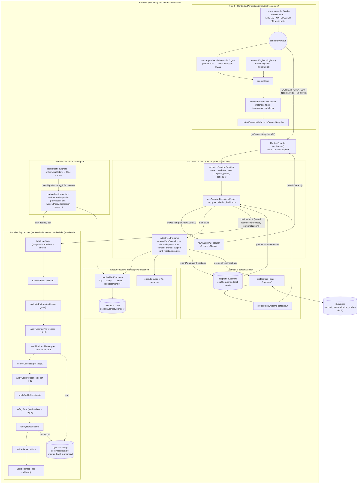
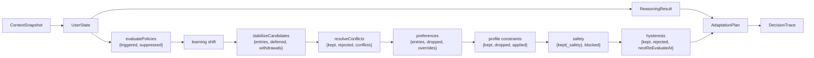
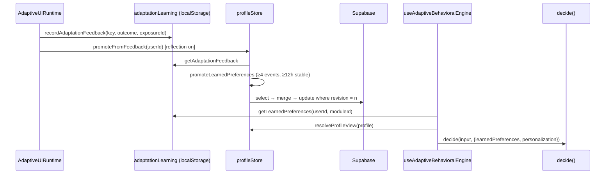

# NeuroBridge Adaptive Engine — Architecture Audit & Learning Guide

**Branch audited:** `adaptive-engine-release` at `18b7df0` (clean working tree)
**Date:** 2026-11-21
**Method:** This guide is built from the source code. Every connection described here was traced through real imports and call sites. The docs were treated as claims to check, not as facts. I made no application-code changes.

**Evidence I gathered myself**

| What | Result |
|---|---|
| `npx vitest run` (whole repo, 129 files) | **1245 passed, 4 failed.** All 4 failures are outside the adaptive engine: `src/test/AgentChatVoice.test.jsx` (1) and `src/test/TaskBreakdownLifecycle.test.jsx` (3). These match the "pre-existing" list in `docs/ADAPTIVE_ENGINE_RELEASE.md` §5. |
| `npx eslint src/adaptive/context/moodAgent.js` | 1 parsing error at `moodAgent.js:355` (`20_000`). Numeric separators are ES2021, but `eslint.config.js` sets `ecmaVersion: 2020`. This is a lint-config problem only; Vite/esbuild compiles the file fine. |
| Read-only engine probe | A scratch script outside the repo, run with `vite-node` and the project's aliases. It called the real `decide()`, `resolvePlanExecution()` and `deriveInterventionRecommendation()`. Results are quoted as **[probe A/B/C]** below. |

**Status labels used in this guide**

| Label | Meaning |
|---|---|
| **IMPLEMENTED** | Code exists, is reachable from `App.jsx` at runtime, and has an effect in a production build. |
| **IMPLEMENTED-INERT** | Code runs in production, but its output has no observable effect, because a flag or missing consumer neutralises it. |
| **PARTIAL** | Some of the documented behaviour exists; part of it is missing or applies to only one path. |
| **DISCONNECTED** | Code exists and is tested, but nothing in the running app calls it. |
| **MOCKED / TEST-ONLY** | Exercised only by tests, or tests replace it with a mock. |
| **PLANNED** | Mentioned in docs or comments, with no implementation. |

---

## Contents

1. [Executive architecture summary](#1-executive-architecture-summary)
2. [Mermaid architecture diagram](#2-mermaid-architecture-diagram)
3. [Repository / module map](#3-repository--module-map)
4. [End-to-end execution walkthrough](#4-end-to-end-execution-walkthrough)
5. [Detailed subsystem explanations](#5-detailed-subsystem-explanations)
6. [Six-task refinement analysis](#6-six-task-refinement-analysis)
7. [Important technical distinctions](#7-important-technical-distinctions)
8. [Architecture gaps and risks (prioritised)](#8-architecture-gaps-and-risks-prioritised)
9. [Test coverage assessment](#9-test-coverage-assessment)
10. [Developer learning guide](#10-developer-learning-guide)

---

## 1. Executive architecture summary

### Purpose
The Adaptive Engine turns live, in-browser observations of user behaviour into a validated **AdaptationPlan**. Observations include pointer bursts, page switches, typing, idle time and (optionally) conversation analysis. Each plan comes with an explainable **DecisionTrace**. The plan says how the UI or a support module should adapt: calmer visuals, fewer choices, guided steps, slower pacing, smaller task steps. A separate execution layer decides what may actually be applied.

### Where it runs (an important, non-obvious fact)
**The entire engine runs in the browser.** `backend/adaptive/**` is plain ES-module JavaScript. Despite the directory name, it is not served by the FastAPI backend. Vite bundles it into the frontend through the `@backend` alias (`vite.config.js:26`, `vitest.config.js`). The Python service (`backend/main.py`, Dockerfile) never executes these files, although the Dockerfile copies them into the Cloud Run image (`Dockerfile: COPY backend/ backend/`). The "context API" `GET /api/context/current` exists only as an in-process function. `src/adaptive/context/api/contextApi.js:39-55` says so explicitly.

### Design principles (as implemented, not just as documented)
1. **Decision is separate from execution.** `decide()` only returns `{ plan, trace }`. Application happens later, in `resolvePlanExecution()` and `AdaptiveUIRuntime`.
2. **Evidence-gated triggering.** A policy fires only when its trigger dimensions are known, fresh and above a confidence floor (`EVIDENCE_THRESHOLDS`, `adaptationPolicy.js:370`).
3. **Categorical precedence.** Ten priority tiers (`supportSchemas.js:122-133`). A lower tier always wins, and numeric priority only breaks ties within a tier.
4. **Temporal stability.** Entry needs persistent evidence, maintenance tolerates weaker evidence, and minimum duration, cooldown and maximum duration all apply (`hysteresis.js`).
5. **Fail-closed safety, fail-safe UI.** The safety gate blocks when it cannot run (`safetyGate.js:204-213`). A failed decision drops back to the baseline UI (`useAdaptiveBehavioralEngine.js:136-144`).
6. **Explainability.** Each action carries `reason` and `evidence`. Each decision carries a schema-validated trace with triggered, rejected and override records.
7. **Staged activation through build-time flags** (`featureFlags.js`).

### What production actually does today (evidence-based)
`.env.production` turns on `RUNTIME=true` and `REFLECTION=true`. `UI_EXECUTION` is unset, so it is off.

| Capability | Production status |
|---|---|
| Context collection, UserState, reasoning, policies, hysteresis, plan, trace | **IMPLEMENTED.** These run on every context change. |
| Adaptive UI modes (low-stimulation, focus, minimal, guided, overwhelm) | **IMPLEMENTED-INERT.** Every UI action is resolved as `REJECTED` (`uiExecution.js:326-329`). All six generic policies target `UI` (`adaptationPolicy.js:181-335`), so the app-wide visual effect is nil. |
| Support card ("Sensory Reset", "5-4-3-2-1 Grounding", …) | **IMPLEMENTED.** This is the main visible output. It is derived from the *raw* plan, not the effective plan (`AdaptiveUIRuntime.jsx:405-412`). |
| Consent prompts | **IMPLEMENTED for non-UI actions in CAUTION modules.** This contradicts the release doc ([probe A], §8 H2). |
| Module-level adaptation (pacing, task, content) | **PARTIAL.** It works on pages that mount `useModuleAdaptation`/`useFeatureAdaptation`. In CAUTION modules, parameters are stripped after consent (§8 H3). |
| Learning from feedback (Task 4) influencing decisions | **Largely IMPLEMENTED-INERT** for UI rules (§8 M1). Card feedback only hides cards. |
| Persistent profile (Task 5) | **IMPLEMENTED** (local + Supabase, once the migration is applied). Its UI-shaping effects are inert because UI execution is off. |
| Executor `executeAdaptation()` | **DISCONNECTED.** No production caller of the hook's `execute()`. |

### Production readiness
The engine core is carefully engineered and heavily unit-tested. That is not enough evidence to call the *adaptive UI* production-ready, and the release doc itself says so. Further concerns: the doc's claim that no consent prompts are shown is contradicted by code (§8 H2), two decision paths share mutable hysteresis state (§8 H4), and there is no browser or E2E verification and no telemetry.

---

## 2. Mermaid architecture diagram



**Subsystem communication summary**
- **Event bus.** Role 1 is decoupled internally through `contextEventBus` (`CONTEXT_UPDATED`, `INTERACTION_UPDATED`, …).
- **React state and context.** `ContextProvider` → `AdaptiveRuntimeProvider` → `AdaptiveUIRuntime`.
- **Direct synchronous calls.** `decide()` is a synchronous function pipeline.
- **Module-level singletons.** Hysteresis `Map`, execution store, planner id counter and flag state are all mutable module singletons.
- **Storage.** `localStorage` holds feedback and the local profile, `sessionStorage` holds consent and dismissals, Supabase holds the profile row.

---

## 3. Repository / module map

### 3.1 Engine core (`backend/adaptive/`, runs in the browser)

| File | Lines | Key exports | Role | Status |
|---|---:|---|---|---|
| `engine/adaptiveEngine.js` | 602 | `decide`, `adaptiveEngine` | The decision pipeline orchestrator | IMPLEMENTED |
| `engine/hysteresis.js` | 717 | `stabilizeCandidates`, `runHysteresisStage`, `resetAdaptiveHysteresis`, `clearAdaptiveHysteresis` | Temporal stability with a module-level state `Map` | IMPLEMENTED |
| `engine/preferences.js` | 371 | `applyUserPreferences` | D14 explicit requests / restrictions / accessibility (Tier 2–4) | IMPLEMENTED |
| `engine/personalization.js` | 217 | `buildPreferenceEvidence`, `applyProfileConstraints`, `partitionInfluences`, `isLearnedAvoided` | Task 5 profile → engine | IMPLEMENTED (UI shaping inert) |
| `engine/safetyGate.js` | 219 | `safetyGate` | Safety disposition per candidate | IMPLEMENTED (narrow; §5.14) |
| `engine/conflictResolution.js` | 163 | `resolveConflicts`, `entriesConflict` | Per-target winner (D4) | IMPLEMENTED |
| `engine/learning.js` | 152 | `applyLearnedPreferences`, `LEARNING_INFLUENCE` | Task 4 bounded evidence shift | IMPLEMENTED (inputs mostly empty) |
| `engine/executor.js` | 151 | `executeAdaptation` | Legacy per-action executor | DISCONNECTED in production |
| `engine/featureFlags.js` | 127 | `isAdaptiveRuntimeEnabled`, `isUIExecutionEnabled`, `isReflectionEnabled`, `configureAdaptiveFlags` | Build-time flags | IMPLEMENTED |
| `engine/role4Signals.js` | 79 | `buildRole4Signals` | Reads the Role 4 local store | IMPLEMENTED (used by reflection only) |
| `reasoning/adaptationPolicy.js` | 733 | `ADAPTATION_POLICIES`, `evaluatePolicies`, `EVIDENCE_THRESHOLDS` | Six generic policies plus the evaluator | IMPLEMENTED; legacy exports dead |
| `reasoning/cognitiveReasoning.js` | 619 | `reasonAboutUserState`, `SITUATION_REGISTRY` | Situation / need / strategy | IMPLEMENTED |
| `reasoning/planner.js` | 317 | `buildAdaptationPlan` | Entries → validated plan | IMPLEMENTED |
| `reasoning/focusConfiguration.js` | 12 | `recommendFocusConfiguration` | Focus-session Tier 9 entry | IMPLEMENTED |
| `reasoning/moduleSelector.js`, `questionEngine.js`, `interventionRanking.js`, `sharedModuleScorer.js`, `disorderFeatureRegistry.js` | small | onboarding / settings helpers | Not part of `decide()` | IMPLEMENTED (onboarding/settings) |
| `state/userStateModel.js` | 1014 | `buildUserState`, `detectStateTransition` | Snapshot → UserState | IMPLEMENTED (`detectStateTransition` unused) |
| `state/snapshotNormalizer.js` | 604 | `normalizeContextSnapshot` | Snapshot → normalized signals plus staleness withdrawal | IMPLEMENTED |

### 3.2 Frontend adaptive layer (`src/adaptive/`, `src/components/adaptive/`, `src/hooks/`)

| File | Role | Status |
|---|---|---|
| `src/context/ContextProvider.jsx` | Owns the live snapshot; subscribes to bus events | IMPLEMENTED |
| `src/adaptive/context/*` (≈20 files) | Role 1 perception: tracker, mood agent, fusion, store, adapter | IMPLEMENTED (conversation path dev-only; §5.1) |
| `src/components/adaptive/adaptiveRuntimeContext.jsx` | `AdaptiveRuntimeProvider`: the app-level decision path | IMPLEMENTED |
| `src/hooks/useAdaptiveBehavioralEngine.js` | React boundary around `decide()` | IMPLEMENTED |
| `src/components/adaptive/AdaptiveUIRuntime.jsx` | Applies the effective UI, consent prompt, support card, feedback capture | IMPLEMENTED |
| `src/adaptive/execution/uiExecution.js` | `resolvePlanExecution`, session consent store, ledger | IMPLEMENTED |
| `src/adaptive/execution/reEvaluationScheduler.js` | Bounded timer | IMPLEMENTED |
| `src/adaptive/learning/adaptationLearning.js` | Feedback event store and Beta-style summaries | IMPLEMENTED |
| `src/adaptive/personalization/{profileModel,profileStore,profileVocabulary,usePersonalizationProfile}.js` | Task 5 profile | IMPLEMENTED |
| `src/components/adaptive/PersonalizationProfilePanel.jsx` | User controls (mounted in `UserSettings.jsx:408`) | IMPLEMENTED |
| `src/adaptive/session/adaptiveSession.js` | Sign-out reset (called from `AuthContext.jsx:530`) | IMPLEMENTED |
| `src/hooks/useModuleAdaptation.js`, `useFeatureAdaptation.js`, `src/adaptive/featureConfiguration.js` | **Second decision path** for module pages | IMPLEMENTED |
| `src/adaptive/reflection/{reflectionEngine,useReflectionSignals}.js` | Role 4 outcome reflection → `strategyEffectiveness` | IMPLEMENTED (module paths only) |
| `src/adaptive/reflection/outcomeAnalysis.js` + `AdaptiveOutcomePanel.jsx` | Dashboard "forecast" panel | IMPLEMENTED, independent of `decide()` |
| `src/adaptive/ui/uiAdapter.js` | UI action validation and config mapping | IMPLEMENTED (as a validator) |
| `src/components/adaptive/AdaptiveEngineBridge.jsx` | Old Phase 4 bridge | **DISCONNECTED** (imported only by its test) |
| `src/adaptive/memory/memorySystem.js` | Old memory system | **TEST-ONLY** (`memorySystemDeprecation.test.js`, `role4Schemas.test.js`) |
| `src/styles/adaptive.css` | CSS driven by `data-adaptive-*` under `.adaptive-root` | IMPLEMENTED (inert while UI execution is off) |

### 3.3 Supporting framework (`src/support/`)

| File | Role for the engine |
|---|---|
| `schemas/supportSchemas.js` (1333 lines) | Zod contracts: `PriorityTier`, `AdaptationPlan`, `DecisionTrace`, `PolicyRule`, `SafetyResult`, … |
| `framework/supportModuleRegistry.js` (1337 lines) | Module definitions, `safetyLevel`, `modulePolicies`, Tier 9 learned-policy factory (`:37-87`) |
| `framework/moduleContextAdapter.js` | `buildModuleContext(moduleId)` |
| `framework/userPreferencesAdapter.js` | `buildUserPreferencesFragment(user)` → D14 input |
| `framework/interventionSelection.js` | `assessSupportSafety` (regex) used by the safety gate |
| `evidence/supportEvidence.js` | `getSupportEvidenceAsync` (focus session only) |
| `persistence/role4Store.js` | Role 4 local store read by `buildRole4Signals` |

### 3.4 Parallel / overlapping systems (not part of `decide()`)
- `src/components/anxiety/{domain,planning,adaptation}/*` is a separate anxiety-specific reasoner, planner and ranker.
- `src/support/{reflection,memory,personalization}/*` is the Role 4 learning pipeline. It overlaps by name with `src/adaptive/{reflection,memory,personalization}`.
- `backend/services/bri_v2/*` (Python) is the chat agent's policy/state system, unrelated to this engine.

---

## 4. End-to-end execution walkthrough

**Traced scenario.** A signed-in user on the dashboard makes a rapid, sustained pointer-movement burst, for example frantically moving the mouse. Production flags apply (`RUNTIME`, `REFLECTION` on; `UI_EXECUTION` off).

### Stage 0 — Bootstrap
- `App.jsx:79-81, 444-447` mounts `<ContextProvider><AdaptiveRuntimeProvider><AdaptiveUIRuntime>…`.
- `ContextProvider` mount effect (`ContextProvider.jsx:54-65`) calls `contextEngine.init()`, which starts the session, activity and environment collectors and subscribes the mood agent to `INTERACTION_UPDATED` (`contextEngine.js:50-97`). It also calls `startInteractionTracking()`, which attaches window listeners (`contextInteractionTracker.js:335-378`). The first snapshot comes from `getContextSnapshotAPI().then(setContext)`.

### Stage 1 — User interaction → context collection

| | |
|---|---|
| **Entry** | `pointermove` listener → `recordPointerMove` (`contextInteractionTracker.js:179`) |
| **Input** | DOM `PointerEvent` (x, y, timestamp) |
| **Processing** | Samples are rate-limited to one per 24 ms. A burst is ≥5 samples within 900 ms, ≥420 px, ≥800 px/s and ≥4 reversals (`:19-24`, `computeMovementBurst:122`). `scheduleEmit` (`:94-106`) throttles to one emission per 80 ms. |
| **Output** | `INTERACTION_UPDATED { interaction: getInteractionSnapshot(), reason, timestamp }` |
| **Next** | `contextEngine`'s subscriber → `moodAgent.handleInteractionSignal` (`moodAgent.js:422`). Also `ContextProvider`'s subscriber (`ContextProvider.jsx:99-108`). |
| **Errors / fallback** | Listeners are passive. A missing `window` makes tracking a no-op. |

`handleInteractionSignal`, on the *start* of a burst, calls `inferMood({ interaction, persist: true })`. `inferFromInteraction` (`moodAgent.js:151-157`) returns `{ value: "stressed", confidence: 0.55 }`, and that is written to `contextStore.mood`. When the burst ends, the mood is held for a grace period and then restored to the pre-burst baseline (`scheduleBurstRestore`, `:391`).

### Stage 2 — Snapshot construction

| | |
|---|---|
| **Entry** | `getContextSnapshotAPI()` (`api/contextApi.js:52`), which is async but actually synchronous inside |
| **Processing** | `fuseContext({})` (`contextFusion.js:114`) computes per-category staleness from `SIGNAL_TTL_SECONDS` (activity 30 s, mood 90 s, conversation 120 s; `signalValidator.js:19-23`), decays dimensional confidence, and stamps `lastUpdated = now`. `toContextSnapshot` (`contextSnapshotAdapter.js:239`) builds the public shape and merges the live `behavior`/`deviceInteraction` from the tracker. |
| **Output** | `ContextSnapshot { snapshotId (random), timestamp, profile, activity, environment, conversation, mood{primaryMood:'stressed',confidence:0.55}, session, behavior{taskSwitchFrequency, movementBurst, confidence:0.7}, deviceInteraction, explicitRequests, metadata{stalenessFlags, dimensionalConfidence, …} }` |
| **Next** | `ContextProvider` `setContext(snapshot)` → re-render → `AdaptiveRuntimeProvider` gets a new `context` → `getSnapshot` callback identity changes (`adaptiveRuntimeContext.jsx:83`) |
| **Errors** | None thrown. Missing categories get defaults (`buildMood` defaults `primaryMood:'unknown'`). |

Note: `snapshotId` contains `Math.random()` (`contextSnapshotAdapter.js:9-12`) and `lastUpdated` is always "now". **Every snapshot is unique**, so the hook's content de-duplication never skips a decision (§8 M4).

### Stage 3 — Runtime input assembly

| | |
|---|---|
| **Entry** | `useAdaptiveBehavioralEngine` decide effect (`useAdaptiveBehavioralEngine.js:269-319`) |
| **Input** | `getSnapshot()`, `moduleId` (from `resolveCanonicalModuleId(pathname)`, `adaptiveRuntimeContext.jsx:49-68`; `null` on `/`), `userId`, `userPreferences` (from `buildUserPreferencesFragment(user)`), `personalizationProfile`, `temporaryPreferences` |
| **Processing** | `++sequenceRef` → await snapshot → `buildInput` (`:146-179`), which builds the module context when a moduleId exists (unknown → generic) and focus-session support evidence → signature check → `decideWithSnapshot` (`:181-232`). That function computes `learnedPreferences = getLearnedPreferences(userId, {moduleId, since})` behind the reflection flag and `personalization = resolveProfileView(profile, …)`, then calls `decide(input, { userId, learnedPreferences, personalization })` (`:209`). |
| **Output** | `AdaptiveEngineInput { contextSnapshot, moduleContext?, role4Signals?, userPreferences?, currentTask?, currentGoal? }` |
| **Errors** | Snapshot or decide errors are caught. When this sequence is the newest, `setError` restores the **baseline** with no plan (`:136-144`, `:224-229`). Superseded sequences are discarded silently. |

### Stage 4 — `decide()`: COLLECT and UserState construction

| | |
|---|---|
| **Entry** | `decide(input, options)` (`adaptiveEngine.js:334`) |
| **Processing** | `validateAdaptiveEngineInput` (zod). When `input.userState` is absent, `buildUserState(contextSnapshot)` (`userStateModel.js:773`) runs `normalizeContextSnapshot` (`snapshotNormalizer.js:495`). That maps mood `stressed` → emotion `anxious` (`MOOD_TO_EMOTION_MAP:81-95`) and withdraws signals whose category is stale (`:503-510`). Nine inferers then produce `DimensionResult { value, confidence, reasons, sources }`. |
| **Output** | `UserState`: flat string values (`mood`, `attention`, `cognitiveLoad`, `stressLevel`, …) plus `_dimensions` with confidences (`createUserStateProxy:869`). [probe B]: `mood: anxious (0.55), attention: scattered (0.56), cognitiveLoad: medium, stressLevel: high, overallConfidence: 0.34` |
| **Errors** | Validation errors throw out of `decide()` and are caught by the hook (Stage 3). |

### Stage 5 — Reasoning

`reasonAboutUserState(userState)` (`cognitiveReasoning.js:566`) matches situations by **value only**: `emotional_distress` needs stress ∈ {high, acute} **and** emotion ∈ {anxious, overwhelmed, panicked}. Confidence is `0.4·overall + 0.4·signalStrength + 0.2·coverage − 0.06·conflicts` (`:469-486`).
**Output:** `ReasoningResult { situation:'emotional_distress', primaryNeed:'emotional_regulation', strategy, reasoning[], confidence:0.59, sources }` [probe B].

### Stage 6 — Policy evaluation (evidence-grounded)
`evaluatePolicies([...ADAPTATION_POLICIES, ...modulePolicies], policyState)` (`adaptationPolicy.js:547`). `low_stimulation` (mood = anxious) matches. Its evidence is 0.55 ≥ `minTriggerConfidence` 0.5, so it is **triggered** with `evidenceConfidence: 0.55`. Other rules either fail to match or are **suppressed** with `evidenceReason`.
Then come `applyLearnedPreferences` (`learning.js:83`), which is a no-op with no sufficient feedback, and `recommendFocusConfiguration`, which applies to focus sessions only.

### Stage 7 — Temporal stabilisation, conflict, preferences, profile, safety
1. `stabilizeCandidates` (`hysteresis.js:262`) is a pure read of hysteresis state. It reinstates, holds or withdraws incumbents and defers challengers.
2. `applyRestrictedDimensions` (`adaptiveEngine.js:180`) applies module hard boundaries.
3. `resolveConflicts` (`conflictResolution.js:120`) picks one winner per target. Opposing types or disagreeing shared parameters count as a conflict.
4. `runPreferenceStage` → `applyUserPreferences` (`preferences.js:311`) adds Tier 2/4 entries and applies Tier 3 restriction filters.
5. `applyProfileConstraints` (`personalization.js:146`) drops avoided modes and applies calmer-only shaping.
6. `runSafetyStage(…, safetyGate)` (`adaptiveEngine.js:233`). On the dashboard (generic, STANDARD) the result is **ALLOW**. In a CAUTION module it is **MODIFY**, with `requireConfirmation` and `reducedIntensity` merged into the parameters [probe A].

### Stage 8 — Hysteresis gate
`runHysteresisStage` (`hysteresis.js:504`) groups entries by target, takes the highest-precedence gated entry, and calls `decideHysteresis` (`:366`).
- t = 0: `low_stimulation` has `confirmationMs: 3000`, and 0.55 < `immediateActivationThreshold` 0.75. The result is **wait_confirmation**: pending state is written, the entry goes to `rejected`, and `nextReEvaluateAt = t+3000`.
- t ≥ 3000 ms, burst still present: **activate**. `activeSince` is written and the entry is kept. [probe B, verbatim override: `activated "low_stimulation" on UI (signal 0.55 ≥ activationThreshold 0.5); entered (… persisted 3500ms)`]

### Stage 9 — Planning and trace
`buildAdaptationPlan` (`planner.js:270`) maps each kept entry 1:1 to an action. **Action confidence is the reasoning confidence (0.59), not the evidence (0.55)**, because shipped rules declare no `confidence` (`deriveActionConfidence`, `planner.js:72`). `reEvaluateAt` is the earliest of now + `minDurationMs`, now + `cooldownMs`, and the hysteresis timer. The trace is assembled and validated (`adaptiveEngine.js:545-585`). There is no persistence: the `persistTrace` hook is never passed by the runtime.

### Stage 10 — Commit and scheduling
Back in the hook, `planSignature(plan)` (`uiExecution.js:95`) is compared with the last committed signature. When it differs, `setDecision(...)`. `onDecision` always fires, and `AdaptiveRuntimeProvider` schedules `refreshContext()` at `reEvaluateAt`, clamped to 1 s–10 min with at most 12 per minute (`reEvaluationScheduler.js`).

### Stage 11 — UI execution (guarded)

| | |
|---|---|
| **Entry** | `AdaptiveUIRuntime` render → `resolvePlanExecution(rawPlan, { trace, runtimeEnabled })` (`AdaptiveUIRuntime.jsx:344-353`) |
| **Processing** | `uiExecution.js:293-405`. The UI action is **REJECTED** ("UI execution disabled") because the flag is off. |
| **Output** | `{ status:'rejected', effectivePlan:null, records:[…], pendingConsent:[], suppressRecommendations:false, signature }`. `deriveUIModeFromPlan(null)` → `mode:'normal'`. Wrapper attributes: `data-adaptive-mode="normal"`, `data-adaptive-execution="rejected"`. |
| **Ledger** | `createExecutionLedger().commit(...)` records the change once (`AdaptiveUIRuntime.jsx:373-399`) |

### Stage 12 — Support card (the visible production effect)
`recommendation = deriveInterventionRecommendation(rawPlan)` is computed whenever `rawPlan.actions.length > 0` (`AdaptiveUIRuntime.jsx:405-412`). `mode === "low_stimulation"` maps to **`sensory_reset`** ("Sensory Reset") (`:188-195`) [probe B]. The card is shown when offers are allowed by the profile (`:431`), the offer isn't dismissed in the session store, and it isn't learned-avoided (`:417-428`).

### Stage 13 — Outcome detection and feedback
- **Start Support** → `respond(cardExposure, ACCEPTED)` → `recordAdaptationFeedback({ key:'RECOMMENDATION:sensory_reset', outcome:'accepted', exposureId, moduleId, decisionId })` (`AdaptiveUIRuntime.jsx:337-343, 560-565`). Then `dismissRecommendation(id)` and the `InterventionModal` opens.
- **Dismiss** → `DISMISSED`. A prompt that is visible for ≥ 8 s and then disappears is recorded as **IGNORED** (`IGNORED_AFTER_MS`, `:78`, `trackExposure:456-463`).
- **Intervention completion** (`onComplete`, `:578-583`) only dismisses. **No completion outcome is recorded** (§8 M10).

### Stage 14 — Persistence
- Feedback events go to `localStorage` key `getRole4StorageKey(userId,'adaptation_feedback')`. There is a cap of 300 events, de-duplicated by `key|exposureId` (`adaptationLearning.js:211-238`).
- When reflection is on, `promoteFromFeedback(userId)` runs (`profileStore.js:435`). It promotes a stance into the profile only after ≥4 events, confidence ≥0.6, score ≥0.75 or ≤0.25, and the same stance held for ≥12 h (`PROFILE_CONFIG`, `profileModel.js:62-71`). The profile is then synced to Supabase with optimistic concurrency (`profileStore.js:325-363`).
- Consent and dismissals go to `sessionStorage` (`neurobridge.adaptive.execution.v1`), bound to the user.

### Stage 15 — Next adaptation
The scheduled refresh, or the next interaction, produces a new snapshot and a new `decide()`. The hysteresis state now has `activeSince`, so `low_stimulation` is **sustained**. After the burst ends, the mood is restored, then `stabilizeCandidates` reinstates or holds the incumbent until `minDurationMs` (20 s) elapses. After that it is **withdrawn** and a cooldown (15 s) is set. Learned preferences only shift *UI* rule evidence when `UI:<ruleId>` keys have feedback. In production such feedback is practically never recorded (§8 M1).

---

## 5. Detailed subsystem explanations

### 5.1 Context Engine
- **Files:** `src/adaptive/context/contextEngine.js` (singleton `ContextEngine`), `contextStore.js`, `contextFusion.js`, `contextSnapshotAdapter.js`, `api/contextApi.js`, `events/*`, `validation/signalValidator.js`, `contextPipeline.js`, `conversationAgent.js`, `moodAgent.js`, `environmentContext.js`, `sessionTracker.js`, `activityTracker.js`.
- **Key functions:** `init`, `ingestSignal` (validate → route to category → fuse → material change → emit), `trackNavigation`, `processUserMessage`, `syncProfile`, `getLatestContextSnapshot`.
- **Data structures:** `UnifiedContextObject` (internal) → `ContextSnapshot` (public, `types/contextTypes.js`).
- **Status:**
  - Navigation, interaction, environment and session collection: IMPLEMENTED.
  - **Conversation analysis is effectively dev-only.** `processUserMessage` is called only from `src/components/dev/ContextInspector.jsx:101`. The production chat (`AgentChat`) does not feed it, so `conversation.urgency` and `explicitRequest` stay at defaults. As a result `critical_urgency` and `urgent_overload` are **unreachable in normal production use**.
  - The inspector renders when `isDebugEnabled()` is true, **or when the URL carries `?contextDebug=1`** (`ContextInspector.jsx:56, 88`). That means a debug panel, with a demo-message button that writes into the live context, is reachable in production builds through a query parameter.
  - `conversationAgent.js` can call Gemini through `callGeminiProxy` (`:24, :167`) when `useAI` is on.
- **Tests:** `src/test/contextEngine.test.js`, `contextInitialNavigation.test.js`, `contextInteractionBurst.test.js`, `moodAgentInteraction.test.js`.

### 5.2 Context and interaction tracking
- **File:** `contextInteractionTracker.js` (633 lines). DOM listeners (`:371-378`), an 80 ms emit throttle (`:94-106`), and navigation windows of 5 minutes (`:13`).
- `getInteractionSnapshot()` (`:487-595`) returns `behavior`, `deviceInteraction`, `explicitRequests` and `biometrics:null`.
- **Confidence is a constant**: `behavior.confidence = 0.7` when any behavioural evidence exists, else `0.0` (`:546-566`). `taskSwitchFrequency = switchCount / 5` (`:516`). One navigation gives 0.2, which maps to "scattered" attention at confidence 0.56 (`userStateModel.js:447-511`).
- **Mood from interaction:** a burst → `'stressed'` at a fixed 0.55 (`moodAgent.js:151-157`).
- **Tests:** `contextInteractionBurst.test.js`, `moodAgentInteraction.test.js`.

### 5.3 UserState model
- **Files:** `backend/adaptive/state/userStateModel.js`, `snapshotNormalizer.js`.
- **Pipeline:** snapshot → 18 normalized signals (`normalizeFreshSignals:567-603`) → 9 dimension inferers → proxy object.
- **Shape:** flat string values, aliases (`mood`, `attention`, `energy`, `engagement`), `overallConfidence` (the mean of the 9 dimension confidences, **including unknown dimensions at 0**), `staleSignals[]`, and `_dimensions{…DimensionResult}`.
- **Staleness:** only `emotion`, `emotionIntensity` and `urgency` are category-stale-gated (`STALENESS_CATEGORY_BY_SIGNAL:521-525`). Explicit requests older than the conversation TTL are withdrawn (`:547-553`). Behaviour counters are not staleness-gated.
- `detectStateTransition` (`:946`) is exported, with no production caller.
- **Tests:** `backend/adaptive/state/__tests__/userStateModel.test.js` (46 cases).

### 5.4 Evidence, confidence and provenance
- **Evidence gate:** `evaluateGroup` (`adaptationPolicy.js:485-529`).
  - Every trigger in an AND group must match.
  - At least one matched trigger needs confidence ≥ 0.5 (`minTriggerConfidence`).
  - Any matched trigger below 0.25 (`minSupportingConfidence`) or stale suppresses the whole group.
  - Dimensions with **no evidence metadata are treated as certain** (`evidenceConfidence = 1`). That covers learned `strategyEffectiveness:*` dimensions and any caller-supplied `userState` without `_dimensions`.
  - Tier 1 rules are exempt from confidence and staleness checks, but not from missing evidence.
- **Provenance:** `action.evidence[]` = reasoning sources + `trigger:<dim> <cond> <value>` + `policy:<id>@v<n>` + `module:<id>` (`planner.js:111-125`). `action.reason` = `Policy "<id>" (v<n>) matched: …`.
- **Downstream parsing of provenance:** `ruleIdOf` in `uiExecution.js:75-81` and `adaptationLearning.js` parses the ruleId back out of `evidence`, or out of the `reason` string with a regex. This is a stringly-typed coupling.
- **Tests:** `evidenceGrounding.test.js` (22), `adaptationPolicy.test.js` (36).

### 5.5 Reasoning Engine
- **File:** `cognitiveReasoning.js`. Seven situations (`:90-98`). Precedence: `urgent_overload`(100) > `emotional_distress`(90) > `cognitive_overload`(80) > `attention_fragmentation`(70) > `low_energy`(60). With no match, the result is `insufficient_information` when fewer than 3 dimensions are known, otherwise `stable`.
- **No evidence gating.** Situations are value-based only, so the situation can be asserted from dimensions the policy layer would suppress. This matters because the support card falls back to `plan.situation` (§8 H5).
- **Tests:** `cognitiveReasoning.test.js` (32).

### 5.6 Adaptation Policy
- **Six generic rules** (`adaptationPolicy.js:181-335`), all `tier: CURRENT_STATE (8)`, `scope: generic`, `target: UI`:

| Rule | Trigger | Mode | Stability profile |
|---|---|---|---|
| `critical_urgency` (110) | urgency = critical | overwhelm | URGENT (no confirmation) |
| `overwhelm_simplification` (100) | cognitiveLoad = overwhelming | overwhelm | DISTRESS |
| `low_stimulation` (90) | mood ∈ {anxious, panicked} (two OR groups) | low_stimulation | DISTRESS |
| `high_load_minimal` (80) | cognitiveLoad = high | minimal | LOAD |
| `scattered_guidance` (70) | attention = scattered | guided | LOAD |
| `focus_mode` (60) | attention = focused | focus | FOCUS |

- **Module rules** (`supportModuleRegistry.js:102-960`) target non-UI dimensions (PACING, TASK, CONTENT, ASSISTANCE, NOTIFICATIONS, INTERACTION). They declare **no `hysteresis`**, so they are never temporally gated (`eligibleForGating`, `hysteresis.js:446-450`).
- **Tier 9 learned rules** (`supportModuleRegistry.js:37-87`): `learned.prefer.*` and `learned.deprioritize.*` on CONTENT, driven by `strategyEffectiveness:<strategyId>`.
- **There is no Tier 1 SAFETY policy anywhere** in the shipped rule sets.
- **Dead legacy exports:** `ADAPTATION_RULES`, `determineAdaptation`, `checkAdaptationRecommendation`, `getAvailableFeatures` have no non-test callers. `selectRules` is used only in its own file.

### 5.7 Temporal hysteresis, thresholds, cooldowns
- **State:** a module-level `Map` keyed `user|module|target` (`hysteresis.js:48, 60-65`). Generic-scope rules use `module="generic"`, so UI state survives navigation (`stateModuleFor:182-184`). The cap is 10 000 entries with oldest-touched eviction, and idle entries are pruned after 30 min (`:112-130`).
- **Profiles** (`adaptationPolicy.js:164-179`):

| Profile | activation | deactivation | confirmationMs | immediate | minDuration | cooldown | maxDuration |
|---|---|---|---|---|---|---|---|
| URGENT | 0.5 | 0.3 | 0 | — | 15 s | 5 s | 5 min |
| DISTRESS | 0.5 | 0.3 | 3 s | 0.75 | 20 s | 15 s | 10 min |
| LOAD | 0.5 | 0.3 | 5 s | 0.85 | 20 s | 20 s | 10 min |
| FOCUS | 0.5 | 0.3 | 8 s | 0.9 | 30 s | 30 s | 15 min |

- **Two-phase design:**
  - `stabilizeCandidates` (read-only, pre-conflict) reinstates "maintained" or "held" incumbents. It withdraws incumbents when evidence is stale, below 0.25, at or below deactivation after dwell, or missing. It defers unconfirmed challengers.
  - `runHysteresisStage` (write) makes the activate, sustain, deactivate or wait decision, then reconciles withdrawals and removals by later stages (`droppedBy`).
- **Signal used:** `entry.confidence` → `entry.evidenceConfidence` → `reasoning.confidence` (`signalFor:191-195`). For shipped rules this is the evidence confidence.
- **Tests:** `hysteresis.test.js` (9), `temporalStability.test.js` (17), `releaseHardening.test.js` (10).

### 5.8 Planner
- `buildAdaptationPlan` (`planner.js:270-317`): 1:1 entry→action, preserves order, validates every action and the plan with zod. `planId`/`actionId`/`traceId` are built from a **module-level counter** (`idSequence`, `:36-41`) plus the timestamp.
- `overallConfidence` = the mean action confidence, which is reasoning confidence for shipped rules (`:212-219`). `userStateReference` = a shallow copy of the full UserState.
- **Tests:** `planner.test.js` (32).

### 5.9 UI execution and execution guards
- **`resolvePlanExecution`** (`uiExecution.js:293-405`). The order is:
  1. runtime flag;
  2. empty plan → IDLE;
  3. per action:
     - UI and flag off → REJECTED;
     - action safety BLOCK/ESCALATE → REJECTED;
     - aggregate safety BLOCK/ESCALATE and not Tier 1 → REJECTED;
     - invalid UI mode → REJECTED (`adaptUIAction`);
     - `requireConfirmation` → DISMISSED if declined, DEFERRED plus `pendingConsent` if undecided;
     - `reducedIntensity` → MODIFIED, **keeping only `reduceMotion`/`reduceAnimations`/`reduceColorIntensity`, for any target** (`reduceIntensity:271-277`);
     - otherwise APPLIED.
- **Session store:** consent and dismissals live in memory plus `sessionStorage`, are bound to one owner, have a 30-min TTL for declines and dismissals, and hold at most 200 entries (`:118-265`).
- **Ledger:** in-memory, idempotent by signature, 50 entries. It records "adaptation withdrawn — baseline UI restored" when an active plan turns idle (`:416-454`).
- **Legacy executor** `executeAdaptation` (`engine/executor.js:235`) applies only the uiExecution flag. It bypasses the safety and consent guards, and "applied: true" means "valid config", not a DOM change. It is reachable only through the hook's `execute()`, which **has no production caller**.
- **Tests:** `adaptiveExecution.test.jsx` (21), `executor.test.js` (10), `uiAdapter.test.js` (19).

### 5.10 AdaptiveUIRuntime and React integration
- **Provider** (`adaptiveRuntimeContext.jsx:77-168`): resolves the module from the route, builds the D14 fragment, loads the personalization profile, binds the execution store to the user (layout effect), runs promotion on load, and creates the scheduler.
- **Hook** (`useAdaptiveBehavioralEngine.js`):
  - a sequence guard prevents stale async commits;
  - a content-signature de-dup, which is ineffective because snapshots are unique;
  - commit only when `planSignature` changes;
  - a reset on `userId` change, declared before the decide effect;
  - `execute()` for the legacy executor.
- **Runtime shell** (`AdaptiveUIRuntime.jsx:321-588`):
  - resolves the effective plan, then folds it into the mode and flags (`deriveUIModeFromPlan:112`);
  - writes `data-adaptive-*` attributes on the wrapper; `className="adaptive-root"` is set only when the runtime is enabled;
  - renders consent and support cards and captures feedback;
  - emits OVERRIDDEN feedback when an applied Tier ≥8 adaptation's target is later taken by an explicit Tier 2–4 action (`:379-397`).
- **Second path:** `useModuleAdaptation` (`src/hooks/useModuleAdaptation.js`) mounts *another* `useAdaptiveBehavioralEngine`. It optionally uses a module-local snapshot and Role 4 signals, does **not** pass the personalization profile, and resolves only non-UI targets. Callers: `FocusSessions.jsx`, `VisualTimeline.jsx`, `AnxietyPage.jsx`, `AdaptiveReadingModule.jsx`, the `depression/*` pages, `EmotionDecoderCard.jsx`, `SocialScenarioSimulatorCard.jsx`, `AdaptiveAnxietyEngine.jsx`, and `useCommunicationAdaptation.js`.
- **Tests:** `AdaptiveUIRuntime.test.jsx` (34), `AdaptiveEngineRuntimeIntegration.test.jsx` (5), `useAdaptiveBehavioralEngine.*.test.jsx`, `featureAdaptationIntegration.test.js`.

### 5.11 Feedback and outcome reflection
There are **two separate loops** that never share data:

1. **Adaptation feedback (Task 4).** `AdaptiveUIRuntime` → `recordAdaptationFeedback` → localStorage → `getLearnedPreferences` → `decide(options.learnedPreferences)`.
   - Keys are `TARGET:ruleId` (consent and overrides) or `RECOMMENDATION:<id>` (cards).
   - Outcome weights: accepted 1/0, rejected 0/1, overridden 0/1, dismissed 0/0.5, ignored 0/0.25.
   - Scoring: 14-day half-life; score = (a+1)/(a+r+2); confidence = w/(w+2); "sufficient" when w ≥ 2.5 and n ≥ 3 (`adaptationLearning.js:59-65, 253-271`).
2. **Role 4 reflection.** `useReflectionSignals(userId)` → `reflectUserHistory` (`reflectionEngine.js:322`) → `buildRole4Signals` (Role 4 local store of intervention outcomes) → `toStrategyEffectiveness` → `role4Signals.strategyEffectiveness` → Tier 9 `learned.*` content policies. **Only module pages pass this in.** The app-level provider never does.

- **Tests:** `learningLoop.test.js` (26), `adaptiveFeedback.test.jsx` (10), `reflectionEngine.test.js` (27), `role4ReflectionIntegration.test.js` (9), `tier9ClosedLoop.test.js`.

### 5.12 Learning and personalization
- **Engine learning stage** (`learning.js:83-152`): for Tier ≥ 8 entries with a sufficient preference, it shifts evidence by up to ±0.15 × confidence (support at score ≥0.65, oppose at ≤0.35). A shift can suppress a triggered rule, or promote a `low_confidence_evidence`-suppressed rule whose evidence is ≥0.25 when it crosses 0.5.
- **Profile → engine** (`personalization.js`):
  - explicit preferred mode → synthetic learned evidence {score 0.85, conf 1};
  - explicit avoided mode → evidence deleted and the rule dropped in `applyProfileConstraints`, except protected rules `critical_urgency` and `overwhelm_simplification` (`profileVocabulary.js:72`);
  - `presentation.reduceMotion` → forces `reduceAnimations:true` on UI actions;
  - `informationDensity:'minimal'` → caps `maxVisibleModules` at 2.
- **Profile model** (`profileModel.js`): explicit, learned and temporary layers; global plus per-module scopes; tombstones; field-level last-writer-wins `mergeProfiles` (`:546`); promotion and demotion hysteresis (`PROFILE_CONFIG`).
- **Tests:** `personalization.test.js` (17), `profileModel.test.js` (21), `profileStore.test.js` (16), `personalizationProfile.test.jsx` (8).

### 5.13 Persistence and cross-session behaviour

| Data | Store | Survives reload | Survives sign-out | Cross-device |
|---|---|---|---|---|
| Hysteresis state | module `Map` | ✗ | ✗ | ✗ |
| Plan / trace | React state | ✗ | ✗ | ✗ (traces are never persisted) |
| Execution ledger | component ref | ✗ | ✗ | ✗ |
| Consent / dismissals | sessionStorage | ✓ (same tab) | ✗ (`resetExecutionStore`) | ✗ |
| Feedback events | localStorage | ✓ | **✗** (`resetAdaptiveSession` + `clearAllLocalAppData`, `AuthContext.jsx:527-531`) | ✗ |
| Profile (explicit + promoted) | localStorage + Supabase | ✓ | local ✗ / remote ✓ | ✓ once the migration is applied |
| Temporary prefs | memory | ✗ | ✗ | ✗ |

Learning therefore survives across sessions only on the same device while the user stays signed in. Across sign-outs or devices it survives only as *promoted* stances, which need the same stance held for ≥ 12 h.

### 5.14 Safety, privacy and feature flags
- **Safety gate** (`safetyGate.js`):
  - It builds a text from the *candidate action* (`target + mode + reason`) and the module context JSON, then runs the regex `assessSupportSafety` over it (`interventionSelection.js:99-128`).
  - **It never sees user content.** In practice the gate is a **module `safetyLevel` floor**: STANDARD → ALLOW; CAUTION → MODIFY with `requireConfirmation` + `reducedIntensity`; ESCALATE → ESCALATE.
  - An exception becomes BLOCK (fail-closed).
  - CAUTION modules: `support.mood_checkin`, `support.accountability_session`, `anxiety.hub`, `dyscalculia.calm-mode`, `support.cognitive_reframing`, `support.gentle_activity`, `support.grounding`, `support.social_connection`, `support.evidence_journal`.
  - In CAUTION modules even explicit Tier 4 accessibility entries get `requireConfirmation`.
- **Privacy:**
  - The profile vocabulary is closed (no diagnoses), the row is protected by RLS, and it cascades on account deletion.
  - Feedback events (`moduleId`, `decisionId`, outcome, timestamp) sit in plaintext localStorage.
  - `deletePersonalizationData` is wired in `UserSettings.jsx:143`.
  - `/api/privacy/export` excludes the profile (acknowledged in the release doc). The Python docstring points to a `PrivacyDataPanel.jsx` that **does not exist** in the repo (`backend/routers/privacy_router.py:50-56`).
- **Feature flags:** read once from `import.meta.env` at module load (`featureFlags.js:59-69`); see §7.8.

### 5.15 Logging, traces and observability
- `DecisionTrace` is produced per decision, validated, kept in React state and `latestTraceRef`, and exposed through `getLatestTrace()`. `persistTrace` exists (`adaptiveEngine.js:588-593`), but the runtime never supplies it. **Traces are never stored or sent anywhere.**
- The execution ledger is in memory only. `onExecution` is not passed in `App.jsx`.
- `contextLogger.js` prints `console.debug` lines only when `VITE_CONTEXT_DEBUG=true` or in dev.
- `data-adaptive-execution` and `data-adaptive-execution-reason` DOM attributes are the only production-observable execution state.
- **There is no production telemetry**, as the release doc admits (§2 blocker 3).

---

## 6. Six-task refinement analysis

Commits on this branch (`git log main..HEAD`): `cab5573` (T1), `bd3cf41` (T2), `bfb169f` (T3), `d63c533` (T4), `cd5a49b` (T5), `18b7df0` (T6).

### Task 1 — Evidence-grounded decisions (`cab5573`)
- **Before:** `evaluatePolicies(rules, state)` returned `{ triggered }`. A trigger group fired when all trigger values matched; confidence and staleness were ignored (removed lines in `git show cab5573 -- adaptationPolicy.js`).
- **Now:**
  - The evidence-gated `evaluateGroup` returns `triggered` plus `suppressed` with `evidenceReason`.
  - Missing or "unknown" values never match, not even `not_in`.
  - The normalizer withdraws stale mood, urgency and explicit-request signals.
  - Suppressed rules appear in `trace.rejectedConditions` and as `overrides{kind:'evidence'}`.
- **Incomplete or disconnected:**
  1. Reasoning (situations) is not evidence-gated, and the support card can fall back to the situation (§8 H5).
  2. The evidence inputs are heuristic constants (0.7 behaviour, 0.55 burst), not measured reliabilities.
  3. Dimensions without metadata are treated as certainty 1.0.
  4. Action confidence shown downstream is reasoning confidence, not evidence (§7.5).

### Task 2 — Temporal stability and hysteresis (`bd3cf41`)
- **Before:** a per-target state with activation and deactivation thresholds, min duration and cooldown, decided per call (no `confirmationMs`, `stabilizeCandidates` or `maxDurationMs`; verified against `bd3cf41^`).
- **Now:**
  - confirmation windows with an immediate-activation override;
  - a pre-conflict stage for maintenance, holds, challengers and withdrawals;
  - a maximum-duration cap;
  - hand-over between modes on one target;
  - generic-scope keys that survive navigation;
  - per-rule stability profiles;
  - provider-side re-evaluation scheduling.
- **Incomplete or disconnected:**
  1. State is in memory, per tab and per JS realm.
  2. `decide()` is no longer side-effect-free, contrary to its header (`adaptiveEngine.js:34-36`).
  3. Two decision paths write the same keys (§8 H4).
  4. Module policies have no hysteresis at all.

### Task 3 — Guarded UI execution (`bfb169f`)
- **Before:** `AdaptiveUIRuntime` applied `deriveUIModeFromPlan(runtime.plan)` directly whenever the runtime flag was on (`bfb169f^:AdaptiveUIRuntime.jsx:281`). The `uiExecution` flag only gated the unused executor, so **with runtime on, UI modes were applied without the UI-execution flag, safety outcomes or consent**.
- **Now:**
  - `resolvePlanExecution` is the single guard;
  - the consent prompt;
  - a session-persistent consent and dismissal store;
  - an idempotent ledger;
  - a sequence guard and plan-signature commit in the hook;
  - `useModuleAdaptation` routes non-UI targets through the same guard.
- **Incomplete or disconnected:**
  1. `reducedIntensity` strips non-UI parameters (§8 H3).
  2. The legacy `executeAdaptation` bypasses all guards except the flag. It is still exported and reachable through `execute()`.
  3. The ledger is in memory and never emitted.
  4. Recommendations are deliberately not gated by the UI flag.

### Task 4 — Feedback-based learning (`d63c533`)
- **Before:** no adaptation-feedback learning. Only Role 4 reflection fed Tier 9 through `strategyEffectiveness`.
- **Now:** `adaptationLearning.js` (event store and decayed Beta summaries), `learning.js` (bounded evidence shift on Tier ≥8), feedback capture in `AdaptiveUIRuntime` (accept, reject, dismiss, ignore, override), and learned card suppression.
- **Incomplete or disconnected:**
  1. With UI execution off, UI rule keys receive feedback only from consent prompts (never shown for UI) and overrides (which need an applied UI action), so **the learning stage is inert for all six generic rules in production**.
  2. Card feedback uses `RECOMMENDATION:*` keys, which `applyLearnedPreferences` never looks up (it only uses `TARGET:ruleId`). Card learning only hides cards.
  3. Intervention completion is not recorded.
  4. "Ignored" is lost if the component unmounts.

### Task 5 — Cross-session personalization (`cd5a49b`)
- **Before:** none (Role 4 had a separate `personalization_profiles` collection, still read by `buildRole4Signals`).
- **Now:** a three-layer profile model, a closed vocabulary, the local store plus Supabase sync with optimistic concurrency and retry, tombstones and reset barriers, promotion and demotion hysteresis, a settings panel, and engine integration (`buildPreferenceEvidence`, `applyProfileConstraints`).
- **Incomplete or disconnected:**
  1. Presentation shaping (`reduceAnimations`, the `maxVisibleModules` cap) only alters UI actions, which never execute. `maxVisibleModules` has **no consumer anywhere** in `src/`.
  2. The module-level decision path ignores the profile entirely.
  3. Last-writer-wins by client clock.
  4. The sync is not verified against live Supabase (release doc §5).
  5. A third, overlapping "personalization" concept adds confusion (§8 L2).

### Task 6 — Production hardening (`18b7df0`)
- **Now:**
  - env-driven flags with `.env.production` (runtime and reflection on);
  - the bounded re-evaluation scheduler;
  - an execution store bound to the user, bounded and pruned;
  - the hook reset on user switch;
  - exposures dropped on user switch;
  - the sign-out reset (`adaptiveSession.js`);
  - a fix so hysteresis can't be held by evidence below 0.25;
  - offline and auth-expiry recovery for the profile;
  - the release document.
- **Incomplete or disconnected:**
  1. Flags are build-time only; there is no kill switch or cohort.
  2. No telemetry.
  3. The release doc's "no consent prompts are shown" is contradicted (§8 H2).
  4. Lint is not clean.
  5. 4 unrelated tests fail.
  6. No browser or E2E verification of any mode.

---

## 7. Important technical distinctions

### 7.1 Decision generation vs actual UI execution
`decide()` *generates* (`adaptiveEngine.js:334`). Execution is `resolvePlanExecution` → `deriveUIModeFromPlan` → DOM attributes (`AdaptiveUIRuntime.jsx:344-491`). In production every UI action is generated and then REJECTED. Module pages use the effective plan through `useModuleAdaptation`.

### 7.2 Planned vs successfully applied adaptations
`plan.actions` holds what the engine wants. `resolution.effectivePlan.actions` plus `records[].status` hold what was applied. `trace.finalActions` equals `plan.actions` and **does not reflect execution**. To know what was applied, read the ledger entry (`onExecution`) or the `data-adaptive-execution` attribute. The support card is derived from the *planned* actions.

### 7.3 User preferences vs inferred user state
- **Explicit:**
  - D14 `userPreferences` from the AuthContext user object: `accessibility`, `requested`, `restricted`. These become Tier 2–4 entries that outrank state.
  - Profile `explicit` layer: preferred and avoided modes, presentation.
- **Inferred:** `UserState` from behaviour (Tier 8).
- **Learned:** feedback summaries (bias on Tier ≥8 evidence) and promoted stances.
- The code keeps these layers separate. However, an explicit preference action can make `plan.actions` non-empty and so surface an *inferred-situation* card (§8 H5).

### 7.4 Current-session vs persistent learning
- **Current session:** the hysteresis state, consent and dismissals (sessionStorage), and temporary preferences.
- **Device-persistent until sign-out:** feedback events.
- **Account-persistent:** profile stances. Promotion needs ≥ 12 h of stance stability, so in practice it needs the user to stay signed in on one device.

### 7.5 Confidence vs evidence strength

| Quantity | Computed in | Used by |
|---|---|---|
| `DimensionResult.confidence` | inferers (`userStateModel.js`) | evidence gate |
| `evidenceConfidence` (strongest matched trigger) | `evaluateGroup` | hysteresis signal, learning shift |
| `reasoning.confidence` (overall/strength/coverage blend) | `computeConfidence` | **`action.confidence` and `plan.overallConfidence`** (shipped rules have no rule confidence) |
| `snapshot.metadata.overallConfidence` | fusion | not used by the engine |

In [probe B] the evidence was 0.55 and the action confidence was 0.59. The UI-facing "confidence" is therefore not the evidence strength.

### 7.6 Activation vs withdrawal
- **Activation** needs signal ≥ 0.5, persisting for `confirmationMs` (or ≥ the immediate threshold), and no active cooldown.
- **Withdrawal** happens when:
  - evidence is stale or missing (immediate);
  - evidence is below 0.25 (immediate);
  - evidence is at or below 0.3 after `minDurationMs`;
  - `maxDurationMs` passes without entry-level evidence;
  - `expiresAt` is reached;
  - a later stage (preference, restriction, safety, conflict) removes the rule.
- Withdrawal starts the cooldown. At execution level a withdrawal shows up as a ledger entry "baseline UI restored".

### 7.7 Synchronous vs asynchronous operations
- **Synchronous:** `decide()` and every engine stage, `resolvePlanExecution`, `getLearnedPreferences`, `recordAdaptationFeedback`, `reflectUserHistory`.
- **Asynchronous:**
  - `getContextSnapshotAPI` (async wrapper over sync code);
  - the hook's `buildInput` (awaits `getSupportEvidenceAsync` only for `support.focus_session`);
  - profile load and sync (Supabase);
  - `promoteFromFeedback` (fire-and-forget, `.catch(()=>{})`);
  - the scheduler timers;
  - the `persistTrace` hook (never awaited, unused).
- The hook's sequence counter is the only guard against out-of-order async completion.

### 7.8 Feature-flag behaviour in development and production

| Context | `.env` file loaded by Vite | runtime | reflection | uiExecution |
|---|---|---|---|---|
| `npm run dev` / `build:dev` (mode development) | `.env`, `.env.development` (both gitignored, absent from repo) | OFF unless set locally | OFF | OFF |
| `npm run build` (mode production) | `.env.production` (committed) | **ON** | **ON** | OFF |
| `vitest` (mode test) | `.env`, `.env.test` | OFF by default; tests flip them with `configureAdaptiveFlags` | OFF | OFF |

Flags are inlined at build time. `configureAdaptiveFlags` mutates module state at runtime, but nothing in the app calls it. `decide()` itself is flag-free.

---

## 8. Architecture gaps and risks (prioritised)

> **Update (follow-up fix, uncommitted):** H2–H5 have been addressed. Regression tests are in `releaseHardening.test.jsx` and `AdaptiveUIRuntime.test.jsx`; 8 of them fail on the pre-fix code.
> - **H2:** the release doc now describes non-UI consent prompts in CAUTION modules accurately, and a real-module test covers them.
> - **H3:** `reducedIntensity` now applies to UI actions only (`uiExecution.js`).
> - **H4:** `decide()` takes a `stateScope` option. `useModuleAdaptation` uses `module:<id>`, passes the personalization profile, and re-resolves on consent changes. `clearAdaptiveHysteresis` clears all of a user's scopes.
> - **H5:** support offers require a Tier 1 or Tier ≥ 8 action (`hasStateDrivenAction`).
>
> The descriptions below record the state as audited.

Severity reflects user-facing or production impact. "Verified" means demonstrated by the probe or by direct code reading. "Plausible" means a code-level risk that was not reproduced at runtime.

### HIGH

**H1 — The adaptive UI has no production effect, while the rest of the stack runs at full cost.** *Verified.*
- All six generic policies target `UI` (`adaptationPolicy.js:181-335`).
- `UI_EXECUTION` is off (`.env.production`), so every UI action is REJECTED (`uiExecution.js:326-329`).
- The engine still runs on every interaction burst.
- This is an honest staged rollout, documented in the release doc. Readers should still not interpret traces or tests as "the app adapts".

**H2 — The release doc's claim that "no consent prompts are shown" in production is false for CAUTION modules.** *Verified [probe A].*
- Evidence: `decide()` with `buildModuleContext("support.grounding")` and `uiExecutionEnabled:false` produced `pendingConsent` for `TASK:grounding.guide_breathing_on_stress` and `PACING:grounding.slow_pace_on_panic`.
- `AdaptiveUIRuntime` renders `pending` for any target (`:516-552`), and `resolveCanonicalModuleId` maps the route to the module.
- The covering test (`releaseHardening.test.jsx:251-261`) uses a synthetic module with **no `modulePolicies`**, so it cannot detect this.

**H3 — `reducedIntensity` erases non-UI action parameters.** *Verified by code reading.*
- `reduceIntensity` (`uiExecution.js:271-277`) keeps only motion and colour keys and is applied to every target (`:359-362`).
- The safety gate adds `reducedIntensity` to every candidate in a CAUTION module (`safetyGate.js` `CAUTION_GUARDRAILS`).
- After the user grants consent, module consumers receive, for example, `TASK/GUIDE {}` instead of `{guidedBreathing:true}`.
- `deriveFeatureSignals` (`featureConfiguration.js:69-87`) is mostly type-based and survives this. `tier9StrategyReference` reads parameters such as `strategyId`, and parameter-dependent consumers lose data.

**H4 — Two independent decision paths share one mutable hysteresis store.** *Plausible race.*
- `AdaptiveRuntimeProvider` and every `useModuleAdaptation` instance call `decide()` with the same `userId` and often the same `moduleId`.
- Generic UI keys are `user|generic|UI` for both (`hysteresis.js:182-187`).
- The module path may use a *module-local* snapshot (`useModuleAdaptation.js:51-53`). Interleaved calls then advance or reset the same confirmation clocks and withdrawals from different evidence. Expect possible flicker, premature activation, or a pending state being "discarded transient" by the other path (`:705-711`).
- The module path also omits `personalizationProfile` (avoided modes not applied there) while still applying `learnedPreferences`.
- Its `resolvePlanExecution` memo does not depend on the execution-store version (`useModuleAdaptation.js:64-68`), so a consent decision is reflected only on its next plan change.
- No test mounts both paths together.

**H5 — A support card can appear with no state-driven trigger.** *Verified [probe C].*
- A user with `accessibility.reduceMotion = true` always has a Tier 4 UI action, so `plan.actions` is non-empty.
- `deriveInterventionRecommendation` falls back to `plan.situation` (`AdaptiveUIRuntime.jsx:226-257`). Reasoning computes the situation **without evidence gating**.
- With one page switch (`taskSwitchFrequency 0.2`), the probe produced `situation: attention_fragmentation` → a `grounding_exercise` card.
- This breaks the documented "card only when the engine triggered an opportunity" contract (`AdaptiveUIRuntime.jsx:19-27, 401-404`) and bypasses Task 1 grounding.

### MEDIUM

**M1 — Task 4 learning barely influences decisions in production** (§6 Task 4). `RECOMMENDATION:*` keys never reach `applyLearnedPreferences`, and UI rule keys get no feedback while UI execution is off.

**M2 — The safety stage is narrow and Tier 1 is empty.**
- The regex runs over engine-generated strings (`safetyGate.js:131-145`), never over user text.
- No `SAFETY` tier policy exists.
- `critical_urgency` is Tier 8 and depends on conversation analysis, which only the dev `ContextInspector` feeds.
- Crisis handling lives elsewhere (for example `backend/services/safety.py` for chat). The engine's "safety" should not be described as user-safety detection.

**M3 — `decide()` claims determinism but has hidden global side effects.** It writes the hysteresis `Map`, increments `idSequence`, and `buildUserState` defaults the timestamp to `new Date()`. Identical inputs give different outputs depending on call history. This is the source of the test-isolation burden: every test calls `resetAdaptiveHysteresis`.

**M4 — Decision frequency and cost.**
- Every `INTERACTION_UPDATED` (≤ 12.5/s during activity) → new snapshot (unique id) → `decide()`.
- Each run includes three or more zod validations (input, every action, plan, trace), two full `JSON.stringify` passes (hook signature and `planSignature`), and iteration over the whole hysteresis map in `stabilizeCandidates` and the reconciliation loop (O(states), up to 10 000).
- On top of that, every module path repeats the work.
- No profiling was done. Treat this as a likely, unmeasured bottleneck on low-end devices.

**M5 — Confidence semantics are inconsistent** (§7.5). Hard-coded input confidences (0.7, 0.55) masquerade as measured reliability. `overallConfidence` averages unknown dimensions as 0.

**M6 — The legacy executor bypasses guards** (`executor.js:161-198`). It is dead in production. If someone wires `execute()`, it would skip safety and consent. It reports `applied:true` for a config validation, not a DOM change.

**M7 — Documentation and runtime contradictions in the hook and provider.**
- The hook header says the userId read path uses `buildRole4Signals` (`useAdaptiveBehavioralEngine.js:13-15, 75-77`). It doesn't, and `AdaptiveEngineBridge.test.jsx:65` asserts `buildRole4Signals` is **not** called.
- The provider says "Single decision path for the running app" (`adaptiveRuntimeContext.jsx:4`), which is false (H4).
- `.env.production` comments still say "execution is the explicit `execute()` step", but nothing calls `execute()`.

**M8 — Personalization presentation effects target unconsumed parameters.** `maxVisibleModules`, `showPrimaryAction`, `showEmergencySupport` and `showCalmingContent` have no consumer in `src/` (grep: zero non-schema hits). Even with UI execution on, only `mode` plus five boolean flags reach the DOM (`deriveUIModeFromPlan:127-148`).

**M9 — Privacy and sync gaps.**
- The profile is missing from `/api/privacy/export` (acknowledged).
- The Python docstring references a non-existent `PrivacyDataPanel.jsx`.
- The behavioural feedback history sits in plaintext localStorage.
- Last-writer-wins by device clock can let a skewed device win.
- Offline edits are lost on sign-out (acknowledged).

**M10 — Outcome detection is incomplete.**
- Intervention completion is not recorded as feedback (`AdaptiveUIRuntime.jsx:578-583`).
- "Ignored" is recorded only when the exposure key changes, so unmounting or navigating away loses it.
- Role 4 intervention outcomes and Task 4 adaptation feedback are separate stores that never meet.

### LOW

**L1 — Dead or unused code.** `AdaptiveEngineBridge.jsx` (test-only); `src/adaptive/memory/memorySystem.js` (test-only); `ADAPTATION_RULES`, `determineAdaptation`, `checkAdaptationRecommendation`, `getAvailableFeatures`, `detectStateTransition`; the `persistTrace` hook; `handleGetContextSnapshot`'s "REST endpoint" framing.

**L2 — Duplicate responsibilities.**
- Three "personalization" concepts: Role 4 `personalization_profiles`, `src/support/personalization` hints, and the Task 5 profile.
- Two reflection engines: `src/adaptive/reflection` and `src/support/reflection`.
- Two memory systems.
- A separate anxiety planner and reasoner (`src/components/anxiety/planning|domain`).
- `ruleIdOf` is duplicated in `uiExecution.js` and `adaptationLearning.js`.

**L3 — Coupling.**
- `backend/adaptive` imports from `src` (`@/support/schemas`, `@/adaptive/context/contextSnapshot`, `@/adaptive/ui/uiAdapter`, `@/adaptive/personalization/profileVocabulary`), and `src` imports `@backend`. That is a bidirectional package dependency. I did not run a file-level cycle detector, so file-level cycles are unverified.
- The hook `useModuleAdaptation` imports a helper from a *component* file (`AdaptiveUIRuntime.jsx`).
- Rule identity is recovered by regex from human-readable `reason` strings.

**L4 — Tooling and hygiene.**
- ESLint `ecmaVersion: 2020` fails on `moodAgent.js:355`.
- The Cloud Run image ships unused JS (`Dockerfile`).
- The committed `vitest.config.js.timestamp-*.mjs` artefact.
- The `backend/adaptive` name misleads readers about where the code runs.

**L5 — Rollout controls.** Build-time flags with no runtime kill switch or cohort gate (acknowledged in the release doc).

**L6 — Debug surface in production.** `?contextDebug=1` mounts `ContextInspector` in production builds (`ContextInspector.jsx:56`). Its demo action injects a conversation message into the live context, which can change engine decisions.

---

## 9. Test coverage assessment

### 9.1 Results (actually run)
`npx vitest run`: **129 files, 1249 tests, 1245 passed, 4 failed**. All failures are in `AgentChatVoice.test.jsx` and `TaskBreakdownLifecycle.test.jsx`, which are outside the engine. All engine, runtime, personalization and learning test files passed. The Python tests (`backend/tests`) were not run.

### 9.2 Subsystem → tests map

| Subsystem | Tests (case count) | Nature |
|---|---|---|
| UserState | `userStateModel.test.js` (46) | pure unit |
| Policy / evidence | `adaptationPolicy.test.js` (36), `evidenceGrounding.test.js` (22) | pure unit plus `decide()` |
| Reasoning | `cognitiveReasoning.test.js` (32) | pure unit |
| Planner | `planner.test.js` (32) | pure unit |
| Engine pipeline | `adaptiveEngine.test.js` (34), `conflictResolution.test.js` (15), `preferences.test.js` (20), `safetyGate.test.js` (11) | unit plus real `decide()` |
| Hysteresis | `hysteresis.test.js` (9), `temporalStability.test.js` (17), `releaseHardening.test.js` (10) | real `decide()` with an injected clock |
| Learning | `learningLoop.test.js` (26), `adaptiveFeedback.test.jsx` (10) | store plus engine plus component |
| Personalization | `personalization.test.js` (17), `profileModel.test.js` (21), `profileStore.test.js` (16), `personalizationProfile.test.jsx` (8) | in-memory remote doubles |
| Execution | `adaptiveExecution.test.jsx` (21), `executor.test.js` (10), `uiAdapter.test.js` (19) | component plus pure |
| Runtime / React | `AdaptiveUIRuntime.test.jsx` (34), `AdaptiveEngineRuntimeIntegration.test.jsx` (5), `AdaptiveEngineBridge.test.jsx` (5), hook tests | jsdom, partly mocked |
| Hardening | `releaseHardening.test.jsx` (16) | mixed |
| Flags | `featureFlags.test.js` (10) | pure |
| Reflection / Tier 9 | `reflectionEngine.test.js` (27), `role4ReflectionIntegration.test.js` (9), `tier9ClosedLoop.test.js`, `featureAdaptationIntegration.test.js` | engine plus module adjustments |
| Context | `contextEngine.test.js`, `contextInteractionBurst.test.js`, `moodAgentInteraction.test.js`, `contextInitialNavigation.test.js` | jsdom |

### 9.3 Tests that verify mocks, or diverge from production
- **`AdaptiveEngineBridge.test.jsx`** mocks `decide` and `buildRole4Signals`, and it tests `AdaptiveEngineBridge`, a component the app doesn't mount. The `buildRole4Signals` mock is vestigial; the test asserts it is not called.
- **`AdaptiveEngineRuntimeIntegration.test.jsx:20-29`** wraps `decide` as `(input) => actual.decide(input)`, **which drops the `options` argument**. Production passes `{userId, learnedPreferences, personalization}`, so this "integration" test exercises a different code path: hysteresis keyed `default`, no learning, no profile.
- **`useAdaptiveBehavioralEngine.regression.test.jsx`** mocks `decide`.
- **Profile store tests** use injected in-memory remote and local doubles. The real Supabase table and RLS are not exercised.
- Most component tests flip flags with `configureAdaptiveFlags`. That is a code path the production app never uses, although the env resolver is unit-tested separately.

### 9.4 Untested or under-tested integration paths
1. Real CAUTION module plus production flags → non-UI consent prompt (H2). The existing test uses a policy-less synthetic module.
2. `reducedIntensity` on non-UI actions (H3). The only reducedIntensity tests are for UI (`adaptiveExecution.test.jsx:169-204`).
3. App-level and module-level decision paths mounted together (H4).
4. An explicit preference plus an ungated situation fallback for the card (H5).
5. ContextProvider → tracker → mood agent → engine → card in one React tree with real timers.
6. Any real browser, visual-mode or E2E verification (acknowledged by the release doc).
7. Supabase sync against a live project with the migration applied.
8. Performance under rapid interaction (M4).
9. Intervention completion → learning (does not exist).

### 9.5 Do tests reflect production behaviour?
Partly.
- Engine-core tests call the real `decide()` with realistic snapshots and an injected clock. They are high-fidelity for the pure pipeline.
- Runtime tests often enable `uiExecution`, which production doesn't, or use synthetic module contexts.
- So the suite is strong evidence that the *algorithms* behave as designed. It is weak evidence about the *production composition*: flags as shipped, real module registry, two decision paths, real storage backends.

---

## 10. Developer learning guide

### 10.1 One-page architecture overview
> **Perceive → Model → Reason → Decide → Stabilise → Guard → Present → Learn.**
>
> 1. **Perceive (Role 1, `src/adaptive/context`).** DOM listeners and the context engine produce a `ContextSnapshot` with per-category freshness. Live signals: navigation, typing, scroll, idle, pointer bursts (→ mood "stressed" 0.55).
> 2. **Model (`backend/adaptive/state`).** The snapshot is normalized, stale point-in-time signals are withdrawn, and 9 dimensions are produced, each with value, confidence, reasons and sources.
> 3. **Reason (`cognitiveReasoning`).** One situation, a primary need and a strategy. Value-based only.
> 4. **Decide (`evaluatePolicies`).** Evidence-gated rules → triggered or suppressed candidates.
> 5. **Bias / stabilise.** Learned evidence (±0.15), temporal stabilisation (incumbents and challengers), conflict per target, explicit preferences (Tier 2–4), profile constraints, safety floor, hysteresis gate.
> 6. **Plan.** Validated `AdaptationPlan` plus `DecisionTrace`. Nothing executed yet.
> 7. **Guard (`resolvePlanExecution`).** Flags → safety → consent → reduced intensity → effective plan.
> 8. **Present (`AdaptiveUIRuntime`).** `data-adaptive-*` attributes (CSS), consent prompt, support card, intervention modal. Module pages read non-UI adjustments through `useModuleAdaptation`.
> 9. **Learn.** Card and consent responses go to the feedback log; reliable stances are promoted into a synced profile; Role 4 outcomes feed Tier 9 module preferences.
>
> **Production today:** steps 1–7 run; step 8 shows cards and non-UI consent but no UI modes; step 9 mostly learns which cards to stop offering.

### 10.2 Component-by-component cheat sheet

| Component | Think of it as | Input → Output | Gotcha |
|---|---|---|---|
| `contextInteractionTracker` | Sensor hub | DOM events → behaviour snapshot | Confidence constants, 80 ms emits |
| `moodAgent` | Mood estimator | burst → `stressed@0.55`, check-in → 1.0 | Restores the baseline after a burst |
| `ContextProvider` | Snapshot owner | bus events → React state | New object per event |
| `buildUserState` | Feature extractor | snapshot → UserState | Stale mood → "unknown" |
| `reasonAboutUserState` | Situation classifier | UserState → ReasoningResult | No evidence gate |
| `evaluatePolicies` | Rule engine | rules + state → triggered/suppressed | Metadata-less dims = certain |
| `stabilizeCandidates` / `runHysteresisStage` | Debouncer with memory | candidates + state Map → kept/rejected + timers | Global mutable state |
| `resolveConflicts` | Arbiter | candidates → one per target | Opposing types or shared-key disagreement |
| `applyUserPreferences` | Explicit-wish injector | D14 fragment → Tier 2–4 entries | Restrictions are Tier 3 filters |
| `safetyGate` | Module safety floor | entry + module → disposition | Doesn't read user text |
| `buildAdaptationPlan` | Serializer | entries → validated plan | Confidence = reasoning confidence |
| `resolvePlanExecution` | Execution firewall | plan → effective plan + records | Strips non-UI params on reducedIntensity |
| `AdaptiveUIRuntime` | Presenter + feedback sensor | resolution → DOM, prompts, feedback | Card uses the raw plan |
| `adaptationLearning` | Feedback ledger | events → preference summaries | Wiped on sign-out |
| `profileStore` / `profileModel` | User-owned settings + promoted habits | edits/feedback → profile ↔ Supabase | LWW by client clock |

### 10.3 Data-flow diagrams

**Decision pipeline with outputs per stage**


**Feedback and persistence loop**


### 10.4 Important data structures (realistic examples)

**ContextSnapshot (trimmed)**
```json
{
  "snapshotId": "snap_2026-11-21T10-00-00-000Z_u123_k3j9x",
  "timestamp": "2026-11-21T10:00:00.000Z",
  "mood": { "primaryMood": "stressed", "valence": 0.5, "arousal": 0.5, "confidence": 0.55, "sources": ["interaction"] },
  "behavior": { "taskSwitchFrequency": 0.2, "movementBurst": { "active": true, "intensity": 0.8 }, "confidence": 0.7, "source": "interactionTracker" },
  "deviceInteraction": { "timeSinceLastInteraction": 0, "currentSessionDuration": 120, "confidence": 0.7 },
  "conversation": { "lastUserMessage": null, "urgency": "unknown", "explicitRequest": null },
  "metadata": { "stalenessFlags": { "mood": false, "conversation": false, "activity": false }, "overallConfidence": 0.83 }
}
```

**UserState (from [probe B])**
```json
{
  "emotionalState": "anxious", "mood": "anxious",
  "attentionState": "scattered", "attention": "scattered",
  "cognitiveLoad": "medium", "stressLevel": "high",
  "overallConfidence": 0.34, "staleSignals": [],
  "_dimensions": {
    "emotionalState": { "value": "anxious", "confidence": 0.55, "reasons": ["Emotion \"anxious\" inferred from mood.primaryMood"], "sources": ["mood.primaryMood"] },
    "attentionState": { "value": "scattered", "confidence": 0.56, "reasons": ["Medium task switching indicates scattered attention"], "sources": ["behavior.taskSwitchFrequency"] }
  }
}
```

**Triggered policy entry (internal)**
```json
{ "ruleId": "low_stimulation", "version": 1, "tier": 8, "priority": 90, "scope": "generic",
  "action": { "type": "MODIFY", "target": "UI", "parameters": { "mode": "low_stimulation", "reduceAnimations": true, "reduceColorIntensity": true } },
  "matchedTriggers": [{ "dimension": "mood", "condition": "eq", "value": "anxious" }],
  "evidenceConfidence": 0.55,
  "hysteresis": { "activationThreshold": 0.5, "deactivationThreshold": 0.3, "confirmationMs": 3000, "immediateActivationThreshold": 0.75, "minDurationMs": 20000, "cooldownMs": 15000, "maxDurationMs": 600000 } }
```

**AdaptationAction (in a plan)**
```json
{ "actionId": "action_1800000003500_7", "type": "MODIFY", "target": "UI",
  "parameters": { "mode": "low_stimulation", "adaptationType": "sensory_reduction", "maxVisibleModules": 3, "reduceAnimations": true, "reduceColorIntensity": true, "showCalmingContent": true },
  "tier": 8, "numericPriority": 90, "confidence": 0.59,
  "reason": "Policy \"low_stimulation\" (v1) matched: mood eq \"anxious\".",
  "evidence": ["mood.primaryMood", "trigger:mood eq \"anxious\"", "policy:low_stimulation@v1"],
  "reversible": true,
  "safety": { "level": "standard", "disposition": "ALLOW", "reasons": [], "guardrails": {} } }
```

**Hysteresis state entry** (key `u2|generic|UI`)
```json
{ "activeSince": 1800000003500, "lastAppliedAt": 1800000006000, "lastConfirmedAt": 1800000006000,
  "lastDeactivatedAt": null, "expiresAt": null, "minDurationMs": 20000, "cooldownMs": 15000,
  "activationThreshold": 0.5, "deactivationThreshold": 0.3, "maxDurationMs": 600000,
  "governingRuleId": "low_stimulation", "lastSignal": 0.55, "lastTransition": "maintained" }
```

**Execution resolution (production flags, dashboard)**
```json
{ "status": "rejected", "reason": "UI execution disabled (VITE_NEUROBRIDGE_ADAPTIVE_UI_EXECUTION is off)",
  "effectivePlan": null, "pendingConsent": [], "suppressRecommendations": false,
  "records": [{ "key": "UI:low_stimulation:{…}", "ruleId": "low_stimulation", "target": "UI", "status": "rejected", "reason": "UI execution disabled (…)" }],
  "signature": "rejected|none|" }
```

**Feedback event and learned summary**
```json
{ "id": "RECOMMENDATION:sensory_reset|shown:RECOMMENDATION:sensory_reset:1800000004000",
  "key": "RECOMMENDATION:sensory_reset", "outcome": "dismissed", "moduleId": "generic",
  "decisionId": "trace_1800000003500_9", "at": 1800000009000 }
```
```json
{ "key": "RECOMMENDATION:sensory_reset", "scope": "global", "score": 0.222, "confidence": 0.556,
  "evidenceWeight": 2.5, "evidenceCount": 5, "ignoredCount": 0, "sufficient": true }
```

**Resolved personalization view (subset, as consumed by the engine)**
```json
{ "revision": 4, "learnedSince": 0,
  "presentation": { "reduceMotion": true, "informationDensity": "minimal", "allowUnrequestedOffers": true },
  "supportModes": { "preferred": [{ "mode": "step_by_step_guidance", "scope": "global" }], "avoided": [{ "mode": "focus_mode", "scope": "global" }] },
  "learned": { "RECOMMENDATION:calm_space": { "stance": "avoided", "score": 0.2, "confidence": 0.7, "evidenceCount": 6, "scope": "global" } } }
```

### 10.5 One end-to-end execution trace (from the real engine, [probe B])
Generic module, user `u2`, snapshot = mood `stressed@0.55`, `taskSwitchFrequency 0.2`, no staleness:

| t | Situation | Plan actions | Hysteresis override (verbatim) | Card |
|---|---|---|---|---|
| 0 ms | emotional_distress (0.59) | none | `"low_stimulation" awaiting confirmation: signal 0.55 must persist 3000ms …` | none |
| 1000 ms | emotional_distress | none | same (re-evaluate in 2000 ms) | none |
| 3500 ms | emotional_distress | `UI/MODIFY tier8 conf=0.59 {mode: low_stimulation, …}` | `activated "low_stimulation" on UI (signal 0.55 ≥ activationThreshold 0.5); entered (… persisted 3500ms)` | `sensory_reset` |
| 6000 ms | emotional_distress | same | `"low_stimulation" on UI sustained (within the hysteresis band)` | `sensory_reset` |

With production flags, `resolvePlanExecution` rejects the UI action. The DOM stays `data-adaptive-mode="normal"`, but the Sensory Reset card appears. Note that `scattered_guidance` (attention scattered at 0.56) also passes the evidence gate. It loses on the UI target to `low_stimulation` (priority 90 > 70).

### 10.6 Glossary

| Term | Meaning in this codebase |
|---|---|
| **ContextSnapshot** | Public Role 1 output describing what is currently known, with freshness metadata |
| **UserState** | 9-dimension model with flat values and `_dimensions` evidence |
| **DimensionResult** | `{ value, confidence, reasons, sources }` |
| **Situation / primary need / strategy** | Reasoning-level labels (e.g. `emotional_distress` / `emotional_regulation`) |
| **PolicyRule** | Declarative rule: tier, priority, scope, triggerGroups (OR of ANDs), action, hysteresis |
| **Tier** | Categorical precedence 1 (Safety) … 10 (Convenience); lower wins |
| **Evidence gate** | `minTriggerConfidence` 0.5 / `minSupportingConfidence` 0.25 / staleness |
| **Suppressed** | Values matched but evidence was too weak or stale; recorded in the trace |
| **Incumbent / challenger** | Currently active rule on a target vs a new competing one |
| **Maintained / held** | Incumbent kept on weaker evidence / kept through brief contradiction until min duration |
| **Confirmation window** | `confirmationMs` that entry evidence must persist |
| **Cooldown** | Minimum time before the same mode can re-enter after withdrawal |
| **Withdrawal** | Deactivation of an active adaptation (with a reason) |
| **D4 / D6 / D14** | Spec decision ids: conflict resolution / hysteresis / user preferences |
| **AdaptationPlan** | Validated list of actions plus situation, confidence, `reEvaluateAt` |
| **DecisionTrace** | Explainability record of triggered, rejected, conflicts, overrides, safety, learning |
| **Effective plan** | Actions that survive `resolvePlanExecution` |
| **Guardrails** | `requireConfirmation`, `reducedIntensity` merged in by the safety stage |
| **Ledger** | Idempotent in-memory log of execution changes |
| **Feedback key** | `TARGET:ruleId` or `RECOMMENDATION:<id>` |
| **Sufficient** | Learned preference with weight ≥ 2.5 and ≥ 3 events |
| **Promotion** | Moving a stable learned stance into the persistent profile |
| **Role 1–4** | Team ownership split: context / adaptive intelligence / experience / support persistence & reflection |
| **Tier 9 learned dimension** | `strategyEffectiveness:<moduleId:interventionType>` overlay from reflection |
| **CAUTION module** | Module whose `safetyLevel` forces MODIFY with consent and reduced intensity |

### 10.7 Twenty technical interview / viva questions with answers

1. **Where does the Adaptive Engine execute?** In the browser. `backend/adaptive` is bundled by Vite through the `@backend` alias. The FastAPI service never runs it.
2. **Why separate `decide()` from execution?** So decisions can be traced, tested and staged independently. `resolvePlanExecution` can then apply flags, safety and consent without the engine knowing about the UI.
3. **What prevents a weak signal from triggering an adaptation?** `evaluateGroup`. It requires one matched trigger with confidence ≥ 0.5, suppresses the group if any matched trigger is < 0.25 or stale, and never lets a missing or "unknown" value match.
4. **How is precedence resolved?** Lower tier wins, then higher numeric priority, then confidence, version and ruleId (`compareConflictPrecedence`). Conflict exists per target when types oppose or shared parameters disagree.
5. **Why does hysteresis have both a pre-conflict and a post-safety stage?** The pre-conflict stage can reinstate incumbents and defer challengers *before* conflict resolution would let a fresh challenger win. The post-safety stage writes state only for candidates that survived every filter.
6. **What does `confirmationMs` protect against?** Transient spikes, such as a 1 s pointer burst, changing the UI. Entry evidence must persist unless it exceeds `immediateActivationThreshold`.
7. **Why can't a profile suppress `overwhelm_simplification`?** It is in `PROTECTED_RULE_IDS` as distress support. Profiles and learned "avoid" stances never reduce it.
8. **What is the difference between `evidenceConfidence` and `action.confidence`?** Evidence is the strongest matched trigger confidence, used for gating, hysteresis and learning. `action.confidence` is the reasoning confidence, because shipped rules declare none.
9. **What happens when `decide()` throws?** The hook catches it. If the decision is still the newest, it sets an idle decision with `error`, so the UI returns to baseline rather than keeping a stale adaptation.
10. **How are stale async decisions prevented from overwriting newer ones?** A monotonically increasing `sequenceRef`. Each await checks `sequence === sequenceRef.current`.
11. **Why is the plan signature used instead of reference equality?** Ids and timestamps change on every decision. `planSignature` compares content (keys, types, tiers, guardrails, safety) so unchanged plans cause no re-render or re-execution.
12. **What does `reducedIntensity` do, and what is its flaw?** It keeps only motion and colour parameters. It is applied to every target, so non-UI actions lose their parameters.
13. **How does feedback become a decision influence?** `getLearnedPreferences` summarises `TARGET:ruleId` events into score and confidence. `applyLearnedPreferences` shifts evidence on Tier ≥8 entries by at most 0.15 × confidence.
14. **Why does card feedback not influence decisions?** It is keyed `RECOMMENDATION:<id>`. The engine only looks up `TARGET:ruleId`. Card feedback only suppresses future cards in `AdaptiveUIRuntime`.
15. **How does cross-device sync avoid lost updates?** Optimistic concurrency (`update … where revision = n`; zero rows → re-fetch, merge, retry) plus field-level LWW merge with tombstones.
16. **What is cleared on sign-out?** The execution store, hysteresis (user and "default"), feedback history, the profile cache and session, plus every `nb_*` localStorage key. The remote profile row stays.
17. **Why is `critical_urgency` unreachable in production?** Urgency comes from conversation analysis (`processUserMessage`), which only the dev ContextInspector invokes.
18. **What are the two decision paths, and why do they matter?** `AdaptiveRuntimeProvider` (app-level, route module) and `useModuleAdaptation` (per page). Both call `decide()` and share the global hysteresis state, which risks interference.
19. **How does the scheduler avoid runaway refresh loops?** One pending timer, delay clamped to 1 s–10 min, and at most 12 refreshes per 60 s window.
20. **What does the safety gate actually inspect?** Engine-generated text (target, mode, reason) plus module context JSON, checked against crisis and diagnosis regexes, then floored by the module `safetyLevel`. It does not inspect user input.

### 10.8 Ten debugging scenarios and how to investigate them

1. **"The UI never changes mode."**
   - Check `data-adaptive-execution` and `data-adaptive-execution-reason` on the root wrapper.
   - In production expect `rejected / UI execution disabled`.
   - Confirm `isUIExecutionEnabled()` and the build mode. Flags are inlined at build time, so a rebuild is needed.
2. **"The support card appears with no obvious reason."**
   - Read `runtime.plan.actions`. A Tier 4 action (e.g. `accessibility.reduceMotion`) makes the gate pass.
   - Then read `plan.situation`. The situation fallback in `deriveInterventionRecommendation` is evidence-ungated (§8 H5).
3. **"An adaptation flickers on and off."**
   - Inspect `trace.overrides` filtered to `kind:'hysteresis'` across consecutive decisions.
   - Check whether a module page with `useModuleAdaptation` is mounted. Two paths write the same hysteresis keys.
   - Look for "discarded transient" entries.
4. **"A rule I expect never fires."**
   - Look in `trace.rejectedConditions` and the evidence overrides for `stale_evidence` or `low_confidence_evidence`.
   - Inspect `userState._dimensions[dim].confidence` and `staleSignals`.
   - Remember mood goes stale after 90 s (`SIGNAL_TTL_SECONDS.mood`).
5. **"Consent prompt keeps reappearing" or "never reappears".**
   - Inspect sessionStorage `neurobridge.adaptive.execution.v1`. Declines expire after 30 min, and the store is wiped on owner change.
   - The key is `adaptationKey` = `target:ruleId:contentParams`. A parameter change creates a new key.
6. **"Module adjustment shows a label but has no effect after I accept."**
   - Check whether the module is CAUTION. If so, `reducedIntensity` emptied the parameters (`uiExecution.js:359`).
   - Compare `engine.plan.actions[i].parameters` with `execution.effectivePlan.actions[i].parameters`.
7. **"Learned preferences do nothing."**
   - Inspect localStorage `nb_role4:v1:<user>:adaptation_feedback`. Are the keys `UI:<rule>` or only `RECOMMENDATION:*`?
   - Check `sufficient` (≥3 events, weight ≥2.5), `isReflectionEnabled()`, and `trace.learning`.
8. **"Profile change on device A doesn't appear on device B."**
   - Check `SyncStatus` from `usePersonalizationProfile`, whether the Supabase migration is applied (a missing table degrades to local-only), the session user matching, and a `revision` mismatch or retry loop (`sync_conflict_retry`).
9. **"Decisions feel slow or the page janks during mouse movement."**
   - Profile `decide()` together with `JSON.stringify` in `signatureOf` and `planSignature`.
   - Count `INTERACTION_UPDATED` emissions (≤12.5/s), the hysteresis `adaptationStateCount()`, and the number of mounted `useModuleAdaptation` instances.
10. **"After switching users, the old user's card or consent shows."**
    - Verify `bindExecutionStoreToUser` ran (`getExecutionStoreOwner()`), the hook's owner-reset effect, and `feedbackOwnerRef` in `AdaptiveUIRuntime`.
    - Check hysteresis keys still prefixed with the old user. `clearAdaptiveHysteresis` runs only on logout, not on a user switch.

---

*End of guide. Generated from source inspection, one full `vitest` run, and a read-only engine probe; no application code was modified.*
